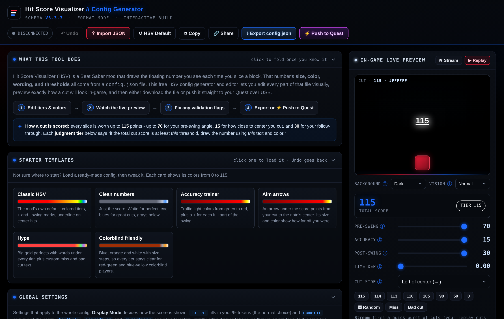

# HSV Config Generator

**A visual config generator and editor, live simulator, and USB deployment tool for Beat Saber's HitScoreVisualizer mod, in a single HTML file.**

### **[▶ Open the app](https://spanky3651.github.io/HSV-Config-Generator/)**

---

## What is this?

[HitScoreVisualizer (HSV)](https://github.com/ErisApps/HitScoreVisualizer) is the Beat Saber mod that draws the floating score you see every time you slice a block. Everything about that popup - its size, color, wording, and the score bands that trigger each style - comes from a `config.json` file that people normally edit by hand, guessing at RGBA float arrays and re-launching the game to see the result.

This tool replaces that loop. You edit every part of the config visually, watch a faithful simulation of how each cut will render in-game, and then either download the file or push it **straight onto a Quest headset over USB** - no BMBF, no SideQuest, no file manager.

## Features

- **Made for first-timers** - a three-step welcome (pick a template, change colors, get it into the game), simple Size / Bold / swing-mark / word buttons on each tier (the raw template is one click away in Code view), advanced settings folded until you need them, and a reminder that the HitScoreVisualizer mod must be installed, with links to BSManager and MBF
- **Export that tells you what's next** - name your file, then get the exact steps: the `Beat Saber\UserData\HitScoreVisualizer` folder and the in-game Select button on PC, Push to Quest or a `.hsv` download for MBF on Quest, plus a picture of what a perfect 115 should look like so you know it worked
- **Judgment tier manager** - add, reorder (drag or nudge), duplicate, and delete score bands, with color pickers, typeable hex fields, and per-tier alpha sliders
- **Live in-game preview** - a simulated cut renders your actual config, including the full set of TextMeshPro rich-text tags the game understands (`<size>`, `<color>`, `<alpha>`, `<mark>`, ``, `<rotate>`…). Tags the game does not know print as plain text, just like in game, with the float-up-and-fade decay animation from VR
- **Score → color spectrum bar** - every score from 0–115 mapped to the exact color your config produces, including Fade blends; click anywhere to simulate that score
- **Fade done right** - HSV's `fade` flag is a *color lerp* between adjacent tiers, not a fade-out; the preview and spectrum both model it
- **Full simulator** - independent pre-swing / accuracy / post-swing / time-dependency sliders, a cut-side control for the `%d` arrow, preset buttons, one-click random cuts, and Miss / Bad cut / Chain head / Chain link previews. Replay plays the follow-through the way the game does, so Intermediate updates and Assume max post-swing are visible
- **Stream preview** - fires a quick burst of cuts across the stage so you can check the text stays readable at speed (it uses your real cuts when a replay is loaded)
- **Backgrounds and color vision** - preview on dark, bright, blue or red lighting, and see your colors the way protanopia, deuteranopia, tritanopia or grayscale vision sees them; validation flags neighbouring tiers that colorblind players can't tell apart
- **Tune from your replays** - drop BeatLeader `.bsor` replays to see how often each tier really shows up for your cuts, then **Even out tiers** suggests thresholds that split your cuts evenly, with a minimum gap between tiers and your 0 tier kept for real bad cuts. See the before and after colors, or Stream your own cuts with the suggestion, before applying it. Chain heads get their own breakdown, and any file that can't be read is listed with the reason. Replays never leave your browser
- **Starter templates** - Classic HSV, Clean numbers, Accuracy trainer, Aim arrows, Hype, and Colorblind friendly
- **Bad cut and miss text** - your own text and colors for misses, wrong-direction cuts, wrong-saber cuts and bombs, with cycle or random order
- **Chains** - text and colors for chain heads (scored 0-85) and chain links, with one click to copy your tiers over
- **Every HSV setting** - display mode (including the default mode older configs use, which now imports untouched), intermediate updates, assume max post-swing, fixed position and target position offset
- **Compare** - pin a version (or load another file) and see both side by side for the same cut, plus a list of what changed
- **Push to Quest over WebUSB** - speaks ADB from the browser (the same approach as ModsBeforeFriday), with device info, config-folder detection, editable destination path and filename
- **Load from Quest** - list the configs already on the headset, open one, edit it, and push it back. Every push first shows what will change compared with the copy on the headset, and keeps the old copy as a `.bak` you can load back
- **USB conflict diagnostics** - detects the classic "interface claim failed" lock caused by SideQuest / Quest Link / Android Studio holding the ADB server, and walks you through fixing it with one-click-copyable kill commands
- **Validation** - duplicate or unreachable thresholds, out-of-range sub-judgments, missing catch-alls, unclosed rich-text tags, tags the game will print as text, missing tokens, chain head rows. Export and Push warn you before writing a config with errors
- **Drop files anywhere** - drop a `.json` config onto the page to import it, or BeatLeader `.bsor` replays to tune your tiers
- **Install it like an app** - in Chrome or Edge, choose **Install app** from the menu (on iPhone, **Add to Home Screen** in Safari). It gets its own icon and opens in its own window, links open in the window you already have, and you can open a config (`.json`, `.hsv`) or a `.bsor` replay from your computer straight into it
- **Import / export with fidelity** - unknown keys from other tools' configs are preserved untouched; 0–255 color arrays are auto-normalized; BOM'd files import cleanly
- **Share by link** - copy a link that opens your exact config (compressed into the link itself, nothing is uploaded)
- **Quality of life** - fold any panel by clicking its header (remembered between visits), autosave (your work survives a closed tab), 30-level undo and redo, click a token to insert it into a template, a compact tier list, two-step deletes, an editable live JSON panel, Ctrl+S export, and an ⓘ explainer on every single control

## How it works

Every Beat Saber cut is scored out of **115**: up to **70** for pre-swing angle, **15** for cut accuracy (distance from block center), and **30** for follow-through. HSV walks your judgment list top-down and uses the first tier whose threshold the total reaches, then renders that tier's text template.

Templates mix literal text, TextMeshPro tags, and tokens:

| Token | Meaning |
|-------|---------|
| `%s` | total cut score |
| `%b` / `%c` / `%a` | raw pre-swing / accuracy / post-swing values |
| `%B` / `%C` / `%A` | substituted text from the sub-judgment lists |
| `%t` / `%T` | time-dependency value / text |
| `%d` | arrow from your cut toward the note center (blank at 15 accuracy) |
| `%n` | newline |
| `%p` | percent of 115 |

The generator opens with the **official HSV default template** (taken from the mod's source, including its trick of opening a `<u>` tag via `%C` so underline only appears on max-accuracy cuts). Everything is a plain HTML file with inline CSS/JS - no frameworks, no build step, no server. Open it from disk or from the live URL; both work identically. Push to Quest uses the [ya-webadb](https://github.com/yume-chan/ya-webadb) ADB stack (MIT), bundled into the page as one matched release, so it needs no network either.

## Push to Quest

Requirements: **Chrome or Edge on desktop**, a USB-C data cable, and a Quest with **Developer Mode** enabled (Meta Quest phone app → your headset → Developer Mode).

1. Plug in the headset and click **Connect** - pick the Quest in the browser's device list
2. Approve **"Allow USB debugging"** inside the headset (tick *Always allow*)
3. Click **Push config** - you see what changes compared with the copy on the headset, then the file lands in `/sdcard/ModData/com.beatgames.beatsaber/Mods/HitScoreVisualizer/`. To edit a config that's already there, pick it under **Configs on headset** and click **Load**
4. In Beat Saber: Mods → HitScoreVisualizer → select the config

If the connection fails with a claim/busy error, another ADB server owns the device - quit SideQuest / Quest Link / Android Studio, run `adb kill-server`, replug, and retry. The app's **⚠ Diagnostics** panel walks through exactly this.

## Running locally

Download `index.html`, double-click it. That's the whole install.

## Compatibility & support

Fair warning: I built this for **my own setup**, and that's what it's tested against. Other setups - different HSV versions, PC vs Quest installs, configs using newer schema features like chain judgments or a fixed position - may not work perfectly out of the box. (The tool preserves any config keys it doesn't understand, so importing and re-exporting won't destroy them, but it can't edit them either.)

That said, **I'm happy to make updates** if something doesn't work for you:

- **Best:** [open an issue](https://github.com/Spanky3651/HSV-Config-Generator/issues) - include your `config.json` and what went wrong
- **Or reach me on Discord:** [MSploit](https://discord.com/users/909550896571113492)

## More tools

Other free, single-file Beat Saber tools by MSploit:

- **[Playlist Studio](https://spanky3651.github.io/Playlist-Studio/?utm_source=github&utm_campaign=readme-hsv-generator)** - Build Beat Saber playlists from BeatLeader and BeatSaver, with your own scores on every map, PP math, and a ready-to-play `.bplist` export.
- **[ReeSaber Studio](https://spanky3651.github.io/ReeSaber-Studio/?utm_source=github&utm_campaign=readme-hsv-generator)** - A visual preset editor for the ReeSabers mod, with curve and gradient editors, a live 3D swing-test preview, a preset gallery, and `.json` / `.reesaber` export.

---

**Developed by [MSploit](https://beatleader.com/u/msploit)** · [BeatLeader profile](https://beatleader.com/u/msploit)

*Not affiliated with Beat Games or the HitScoreVisualizer maintainers.*

